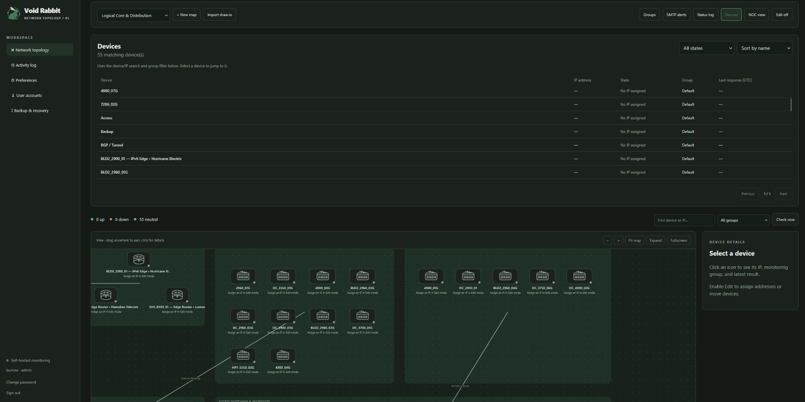
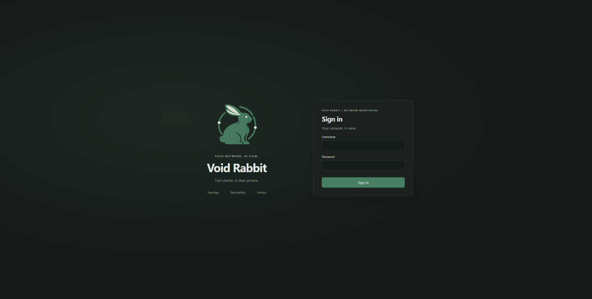

<p align="center">
  
</p>

# Void Rabbit 0.5

A self-hosted Rust network topology monitor with draw.io import, router/switch/server/host icons, scheduled IPv4/IPv6 checks, monitoring groups, optional SMTP alerts, account authentication, custom notification sounds, and persistent UTC activity history. The inventory UI and APIs have been removed. Existing SQLite inventory tables are left intact during upgrades.

## Screenshots

### Network dashboard



### Sign in



## Windows 11 quick start

Install Rust with the MSVC toolchain and the Visual Studio C++ build tools if they are not already installed. Extract this archive, open PowerShell in the `void-rabbit` folder, and run:

```powershell
cargo build --release --locked
.\target\release\void-rabbit.exe
```

Open `http://localhost:8080`. The server listens on `0.0.0.0:8080` by default. Other LAN clients use `http://YOUR-SERVER-IP:8080`. Allow inbound TCP 8080 through Windows Firewall if needed.

On the first launch, the server console prints `INITIAL ADMIN SETUP KEY`. Enter that key in the browser, choose your admin username, and choose a password of at least 12 characters. There is no default password or unauthenticated access mode. The setup key changes when the server restarts and cannot create another initial admin once an account exists.

Windows checks use the native `%SystemRoot%\System32\PING.EXE`, with `-n 1 -w 2000` and the correct IP family. Earlier releases incorrectly used Linux arguments on Windows. Disabling the old access token was unrelated to ICMP checks. An echo reply is required; Windows reporting an unreachable destination with a zero exit code is not considered a healthy device.

Use **Preferences → Ping diagnostic** to test from the server and see the result or utility error. Native monitoring continues with the browser closed. Addresses must be IP literals; no shell commands or hostnames are executed.

## Using the map

- Import a `.drawio` or XML diagram, including compressed or multi-page diagrams, or create a blank map.
- Enable **Edit** to assign IPs and groups, add devices/connections, or reposition devices. Changes use revision checks to avoid overwriting concurrent edits.
- In view mode, drag anywhere—including over devices and containers—to pan. A short click opens details. Scroll to zoom around the pointer; **Fit map** resets the view.
- **Expand** hides the details column. **Fullscreen** fills the display; Escape exits. Drag the bottom-right canvas corner to change its height. Pan, zoom, canvas height, expanded view, device-list visibility, and NOC mode are saved per account and map. Device positions are saved for everyone.
- In Edit mode, click a connection to select it, then choose **Remove connection**. Remove a device from its details form. **Undo** restores the last saved device or connection edit; up to 20 edits are retained per map, shared by editors. Undo uses the latest revision and preserves current monitoring results where the IP is unchanged. Map deletion and group policy changes cannot be undone.
- **Devices** opens a searchable, sortable list; choose a name to center the map on that device. **NOC view** fills the window with the map, counts, legend, brand, and UTC clock. Use **Exit NOC view** to return.
- Device details show the last successful response, time in the current state, and **Outage history** with start, recovery, and duration. Outages reflect scheduled checks and the group failure threshold.
- Monitoring groups set a 1–10 minute interval, 1–5 failed checks before red, enabled/paused state, and optional email down/recovery notifications.
- Utility errors appear as check errors, rather than silently being treated as a device failure. Group/device pauses suppress checks.

## Appearance and notification sounds

The default theme is inspired by Void Linux: charcoal surfaces and a green accent. Use the top appearance toggle for dark/light mode, or **Preferences** for accent presets and a custom color. Preferences are saved per account.

Enable device-down sound in Preferences, click **Test sound** to activate browser audio, then save. A new transition to red plays one alert; repeated refreshes of the same down state do not replay it. The initial page load establishes a baseline without sounding old incidents. Upload WAV, MP3, or OGG files up to 5 MB, or choose the built-in tone. Custom sounds are stored privately with the user's account in SQLite.

Browser audio requires a user gesture and an open, signed-in app. Background tabs may be throttled by the browser. Server checks and SMTP delivery continue independently.

## Accounts and access

- **Admin:** maps, groups, SMTP, users, logs, and own preferences.
- **Operator:** maps, groups, logs, and own preferences; no SMTP or user administration.
- **Viewer:** maps, group policies, logs, and own preferences; no topology edits.

User accounts use salted Argon2id password hashes. Sessions expire after eight hours, use HttpOnly SameSite Strict cookies, and store only a token hash in SQLite. Mutations require a CSRF token. Initial setup and login attempts are rate limited. Password changes, resets, disabling an account, and role changes revoke the affected user's sessions. The final enabled admin cannot be disabled or demoted.

Use **User accounts** to add users, change roles, disable accounts, or reset passwords. Any user can change their own password. An administrator can reset a forgotten password. There is no email recovery flow.

For HTTPS through a reverse proxy, set `TOPOLOGY_SECURE_COOKIE=true`. With the default HTTP configuration, use a trusted LAN; HTTP does not encrypt credentials in transit. Store the database somewhere access-controlled. SMTP credentials must remain recoverable for delivery and are stored in the database, unlike account password hashes.

## UTC and activity history

The header displays UTC, and all displayed event/check timestamps use UTC. Server records use Unix timestamps; the header clock follows the browser computer's clock. Keep both computer clocks synchronized.

**Activity log** persists login/setup successes and failures, logout, account/password changes, device edits and every completed scheduled check, status changes, diagnostic errors, map/import/connection edits, group policy changes, preference changes, SMTP configuration actions, and SMTP delivery results. Records identify the user or `monitor`/`mailer`, the action, device/configuration details where applicable, and result. Passwords, setup keys, session tokens, custom sound data, and SMTP secrets are excluded from activity records.

Search the log and load older entries in pages of 100. Records have no automatic expiry. Back up the database and monitor its size on large networks. API reads and page navigation are not individually logged. Administrators with direct access to the SQLite file can alter logs; this is operational history, not a tamper-evident audit system.

## Configuration

Native runs read shell environment variables, not `.env` files. Existing `ITAM_BIND` and `ITAM_DB_PATH` are accepted as fallbacks.

| Variable | Default | Purpose |
| --- | --- | --- |
| `TOPOLOGY_BIND` | `0.0.0.0:8080` | Listen address |
| `TOPOLOGY_DB_PATH` | `data/itam.sqlite` | Persistent database |
| `TOPOLOGY_SECURE_COOKIE` | `false` | Use Secure cookies when served over HTTPS |
| `TOPOLOGY_PING_PATH` | OS ping utility | Optional absolute path to a trusted ping executable |

Example PowerShell:

```powershell
$env:TOPOLOGY_BIND = "0.0.0.0:8080"
$env:TOPOLOGY_DB_PATH = "C:\VoidRabbit\data\itam.sqlite"
.\target\release\void-rabbit.exe
```

## Linux and Docker

Native Linux needs Rust and `iputils-ping` with ICMP permissions:

```bash
cargo build --release --locked
./target/release/void-rabbit
```

For Docker, copy `.env.example` to `.env`, then:

```bash
docker compose up --build -d
docker compose logs itam
```

Read the initial setup key from the logs. Compose grants `NET_RAW` and stores SQLite in the configured data volume. Docker checks originate inside its network namespace; its reachability may differ from the host. On Windows, run natively when you need the host's LAN routing.

## Upgrading and backups

Stop the previous process, back up its database, and replace the application files while keeping the same database path. The executable is now `void-rabbit.exe` on Windows and `void-rabbit` on Linux. The default database remains `data/itam.sqlite` so existing installations retain their data. Maps, accounts, preferences, SMTP settings, sounds, and history migrate automatically. Create the initial admin only when upgrading from a release without accounts. Existing inventory tables are preserved but no longer exposed. `ITAM_API_TOKEN` is no longer used.

Admins can use **Backup & recovery → Download database backup** while the app runs. It produces a consistent SQLite snapshot, including data currently in WAL. The backup includes account hashes and recoverable SMTP credentials; keep it private. To restore, stop the server, preserve the current database together with its `-wal`/`-shm` files, replace the database with the downloaded snapshot, remove the old WAL/SHM files after preserving them, and restart with the same database path. Keep the existing Docker volume when upgrading.

If an admin password is lost, run this on the server computer with the same database path configured:

```powershell
.\target\release\void-rabbit.exe recover-admin admin
```

Linux:

```bash
./target/release/void-rabbit recover-admin admin
```

Replace `admin` with the existing admin username. Enter and confirm the new password at the hidden prompts. Recovery re-enables that admin and revokes its sessions; it does not create accounts or promote other users. Stop the running server first for a clean maintenance window.

## Validation

```bash
cargo test --locked
cargo clippy --all-targets -- -D warnings
cargo fmt --check
```

See `TESTING.md` for verified behavior and environment limitations. The release archive contains source, not a precompiled Windows executable.
